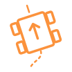

<p align="center">
  
</p>

<h1 align="center">ParrotPlate</h1>

<p align="center">A modular PROS-based robotics template framework for VEX V5 competitive robotics.</p>

ParrotPlate provides a clean, well-documented foundation for building high-performance VEX V5 robots. It handles the complex infrastructure — PID control, odometry, motion planning, and brain screen GUI — so your team can focus on strategy and mechanism design.

## Features

- **Chassis control** — arcade/tank driver control with joystick curves, heading correction, and deadzone handling
- **Autonomous movement** — forward, backward, turn-to, swing turn, and point-to-point motion commands with timeout protection
- **Odometry** — field-relative position tracking using tracking wheels and/or IMU with automatic sensor fusion
- **PID framework** — reusable controller with slew rate limiting, anti-windup, derivative filtering, and settle detection
- **Brain screen GUI** — tab-based page system with autonomous selector, odometry display, and motor/battery diagnostics
- **Modular architecture** — clean separation between library code and user code

## Quick Start

### 1. Set up PROS

Install the [PROS CLI](https://pros.cs.purdue.edu/v5/getting-started.html) and create a new V5 project, or clone this repo as your starting point.

### 2. Configure your robot

Edit **`src/robot/config.cpp`** to match your hardware:

```cpp
parrot::Chassis chassis({
    .left_motors  = {-1, -2, -3},    // Negative = reversed
    .right_motors = {4, 5, 6},
    .motor_rpm      = 200,            // Green cartridge
    .gear_ratio     = 60.0 / 36.0,
    .wheel_diameter = 3.25,           // inches
    .imu_port = 10,
    // ... PID tuning values ...
});
```

### 3. Write an autonomous

Add routines in **`src/robot/autons.cpp`**:

```cpp
void auton::left_side_awp() {
    robot::chassis.set_pose({-48, -48, 90});
    robot::chassis.move_forward(24, 2000);     // 24 inches, 2s timeout
    robot::chassis.turn_to(180, 1500);         // face 180°, 1.5s timeout
    robot::chassis.move_to(0, 0, 3000);        // drive to origin, 3s timeout
}
```

Register them in **`src/robot/config.cpp`**:

```cpp
parrot::AutonSelector auton_selector({
    {"Left AWP",   auton::left_side_awp},
    {"Right Elim", auton::right_side_elim},
    {"Skills",     auton::skills},
    {"Do Nothing", auton::do_nothing},
});
```

### 4. Build and upload

```bash
pros make        # Build
pros mu          # Build and upload to V5 Brain
pros terminal    # View debug output over USB
```

## Project Structure

```
parrotplate/
├── include/
│   ├── main.h                          # PROS main header
│   ├── parrotlib/                      # ── Library headers ──
│   │   ├── parrotlib.hpp               # Master include
│   │   ├── core/
│   │   │   ├── pid.hpp                 # PID controller
│   │   │   ├── slew.hpp               # Slew rate limiter
│   │   │   ├── timer.hpp              # Timer utility
│   │   │   └── math_utils.hpp         # Angle/distance math
│   │   ├── chassis/
│   │   │   ├── chassis.hpp            # Main chassis class
│   │   │   ├── chassis_config.hpp     # Configuration structs
│   │   │   └── drivetrain.hpp         # Low-level motor control
│   │   ├── odom/
│   │   │   ├── odometry.hpp           # Position tracking engine
│   │   │   ├── pose.hpp               # (x, y, heading) struct
│   │   │   └── tracking_wheel.hpp     # Encoder abstraction
│   │   ├── gui/
│   │   │   ├── screen.hpp             # Screen manager
│   │   │   ├── page.hpp               # Base page class
│   │   │   ├── auton_selector.hpp     # Autonomous selector page
│   │   │   ├── odom_page.hpp          # Odometry display page
│   │   │   └── info_page.hpp          # Battery/motor/sensor page
│   │   └── utils/
│   │       ├── logger.hpp             # Debug logger
│   │       └── units.hpp              # Unit conversions
│   └── robot/                          # ── User headers ──
│       ├── config.hpp                  # Robot configuration
│       ├── subsystems.hpp             # Mechanism declarations
│       └── autons.hpp                 # Autonomous declarations
├── src/
│   ├── main.cpp                        # PROS entry point
│   ├── parrotlib/                      # Library implementations
│   │   └── (mirrors include structure)
│   └── robot/                          # ── User code ──
│       ├── config.cpp                  # Hardware setup & PID tuning
│       ├── subsystems.cpp             # Mechanism implementations
│       └── autons.cpp                 # Autonomous routines
├── Makefile
└── project.pros
```

**Library code** (`parrotlib/`) is the framework — you shouldn't need to modify it.
**User code** (`robot/`) is where your robot-specific logic goes.

## Coordinate System

ParrotPlate uses a consistent coordinate convention everywhere:

| Property | Convention |
|----------|-----------|
| X axis | Positive to the **right** |
| Y axis | Positive **forward** |
| Heading 0° | Facing **forward** (+Y direction) |
| Heading direction | **Clockwise** positive |
| Distance unit | **Inches** |
| Angle unit | **Degrees** |
| Time unit | **Milliseconds** |

The origin `(0, 0)` is wherever `set_pose()` or `reset()` was last called — typically the robot's starting position for each autonomous routine.

## API Reference

### Chassis

```cpp
// Driver control
chassis.arcade(forward, turn);
chassis.tank(left, right);

// Autonomous movement (all blocking by default)
chassis.move_forward(distance_inches, timeout_ms);
chassis.move_backward(distance_inches, timeout_ms);
chassis.turn_to(heading_degrees, timeout_ms);
chassis.swing_to(heading_degrees, parrot::Side::LEFT, timeout_ms);
chassis.move_to(x, y, timeout_ms);

// Per-motion overrides — tweak any param for a single call
chassis.move_forward(6, 1500, {.max_speed = 60, .tolerance = 0.25, .settle_time = 300});
chassis.turn_to(90, 1500, {.tolerance = 3.0, .gains = {3.5, 0, 22.0}});
chassis.move_to(24, 48, 3000, {.settle_radius = 0.5, .drive_gains = {6.0, 0, 40.0}});

// Per-auton settle tuning — set at the top of an auton routine
chassis.reset_pid_defaults();           // clean slate
chassis.set_drive_settle(0.3, 250);     // tolerance (inches), settle_time (ms)
chassis.set_turn_settle(0.8, 150);      // tolerance (degrees), settle_time (ms)
chassis.set_move_to_settle(0.5, 250);

// Full PID replacement at runtime
chassis.set_drive_pid({.gains = {8, 0, 50}, .tolerance = 0.5, .settle_time = 200});

// Async movement — returns immediately
chassis.move_forward(24, 2000, {.async = true});
chassis.wait_until_settled();

// Position
chassis.set_pose({x, y, heading});
chassis.get_pose();
chassis.reset_pose();
chassis.reset_heading(0);
```

### PID

```cpp
parrot::PID pid({
    .gains       = {5.0, 0.0, 35.0},
    .tolerance   = 0.5,
    .settle_time = 200,
});

while (!pid.is_settled()) {
    double output = pid.update(target - current);
    motor.move(output);
    parrot::delay(10);
}
```

### Odometry

```cpp
parrot::Pose pos = chassis.get_pose();
double dist = pos.distance_to({24, 24});
double angle = pos.angle_to({24, 24});
```

### GUI

```cpp
parrot::Screen screen;
screen.add_page(new parrot::AutonSelector(routines));
screen.add_page(new parrot::OdomPage(odometry));
screen.add_page(new parrot::InfoPage(motors, imu_port));
screen.start();
```

## PID Tuning Guide

1. **Start with kP only** (kI = 0, kD = 0). Increase until the robot reaches the target. It will oscillate — that's expected.
2. **Add kD** to dampen the oscillation. Start at 5-10x your kP value and increase until oscillation stops. If it gets jittery, back off.
3. **Add kI only if needed** — if there's a consistent steady-state error (robot stops a bit short). Keep it very small (0.001-0.01x kP). Set `windup_range` to prevent buildup during the approach.
4. **Tune in order**: drive → heading → turn → swing. Get straight-line driving solid first.
5. **Use the logger**: `pros terminal` shows PID debug output in real time.

## Adding Subsystems

1. Declare functions in `include/robot/subsystems.hpp`
2. Implement in `src/robot/subsystems.cpp`
3. Call from `opcontrol()` in `src/main.cpp`

```cpp
// In subsystems.hpp:
namespace robot::intake {
    void spin(int voltage);
    void stop();
}

// In subsystems.cpp:
static pros::Motor intake_motor(7);
namespace robot::intake {
    void spin(int voltage) { intake_motor.move(voltage); }
    void stop() { intake_motor.move(0); }
}

// In opcontrol():
if (controller.get_digital(DIGITAL_R1)) robot::intake::spin(127);
else robot::intake::stop();
```

## Adding GUI Pages

Create a class that inherits from `parrot::Page`:

```cpp
class MyPage : public parrot::Page {
public:
    MyPage() : Page("Custom") {}
    void render() override {
        clear();
        draw_text(10, 10, "Hello from my custom page!");
    }
};

// In initialize():
screen.add_page(new MyPage());
```

## Requirements

- [PROS CLI](https://pros.cs.purdue.edu/v5/) 4.x
- VEX V5 Brain + Controller
- `arm-none-eabi-gcc` toolchain (installed with PROS)

## License

MIT — use it, modify it, win with it.
